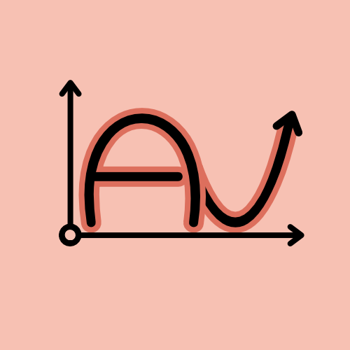
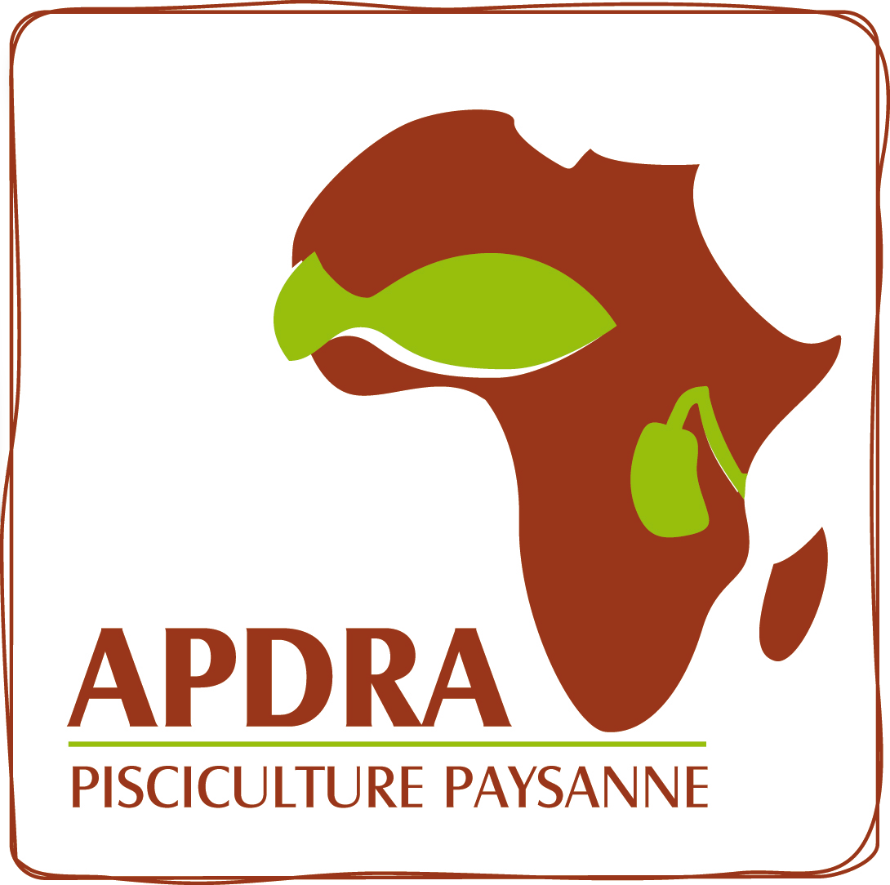
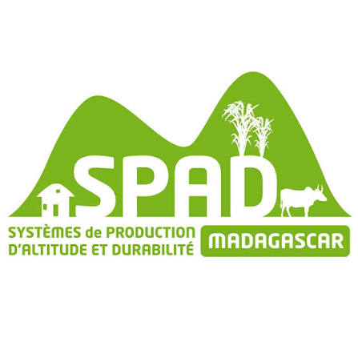
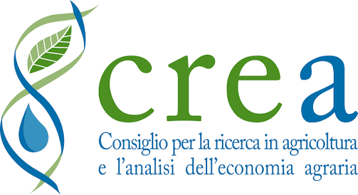
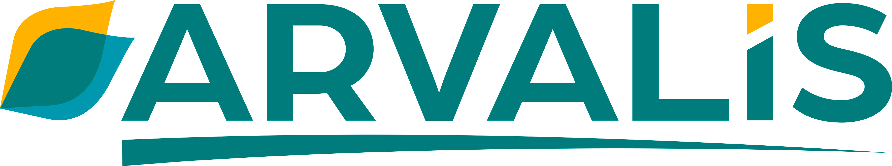

::::::::::::::: {.band .band-lila .hero}
:::::::::::::: band-inner
::::::::::::: hero-flex
::::::::::: hero-texto
```{=html}
<p class="hola"><span class="c1">Hola!</span> <span class="c2">Coucou!</span> <span class="c3">Hello!</span></p>
```

# Welcome!

```{=html}
<svg class="wave" width="280" height="16" viewBox="0 0 244 16" aria-hidden="true">
  <path d="M2 8 q15 -10 30 0 t30 0 t30 0 t30 0 t30 0 t30 0 t30 0 t30 0"
        fill="none" stroke="#f19e8c" stroke-width="5" stroke-linecap="round"/>
</svg>
<p class="nombre">@Ana Valladares</p>
```

:::::::::: animated-text
Making data

::::::::: flip
<div>

<div>

Fun

</div>

</div>

<div>

<div>

Clear

</div>

</div>

<div>

<div>

Easy

</div>

</div>
:::::::::

for all your projects!
::::::::::

[Let's talk](contact.qmd){.btn .btn-primary}
:::::::::::

::: hero-logo
```{=html}
<div class="circulo"></div>
```
:::
:::::::::::::
::::::::::::::
:::::::::::::::

:::::::::::::::::: band
::::::::::::::::: band-inner
## How can I help you?

:::::::::::::::: grid
::: g-col-12
#### Hey, I’m so glad you’re here! 🌸 {.g-col-12}

#### Welcome to my personal website — a space where I share my love for data, creativity, and of course, teaching. {.g-col-12}

#### Here you’ll find content about R, Python, data science, and other things I explore along the way. {.g-col-12}

#### If you’re curious about how I can help you, here’s what I offer: {.g-col-12}
:::

:::::: {.g-col-12 .g-col-md-4}
::::: {.card .text-white .bg-secondary}
::: card-header
📊 Data analysis
:::

::: card-body
<p class="card-text">

Data analysis & visualization: let’s unlock the value of your data with statistics, graphs, and insights, always aiming for results that are reproducible and automated.

</p>
:::
:::::
::::::

:::::: {.g-col-12 .g-col-md-4}
::::: {.card .text-white .bg-info}
::: card-header
🎓 Trainings
:::

::: card-body
<p class="card-text">

Workshops and trainings in R, Python, or data management, designed to help you optimize your analyses and grow your skills with confidence.

</p>
:::
:::::
::::::

:::::: {.g-col-12 .g-col-md-4}
::::: {.card .text-white .bg-success}
::: card-header
💡 Tips & Blog
:::

::: card-body
<p class="card-text">

On my <a href="projects.qmd" style="color: #0056b3; text-decoration: underline;">blog</a>, I share resources, tutorials, and reflections.It’s my way of passing along what has helped me, hoping it inspires you too.

</p>
:::
:::::
::::::
::::::::::::::::
:::::::::::::::::
::::::::::::::::::

::::: {.band .band-azul}
:::: band-inner
## Tools that I use

::: pills
[R]{.pill .p1} [Python]{.pill .p2} [Quarto]{.pill .p1} [RStudio]{.pill .p2} [SQL]{.pill .p1} [Tableau]{.pill .p2} [QGIS]{.pill .p1}
:::

[See my portfolio](projects.qmd){.btn .btn-primary .btn-grande}
::::
:::::

:::: {.band .band-durazno}
::: band-inner
## Our Network

### Meet the organizations and collectives AV has had, and continues to have, the pleasure of working with.

```{=html}
<div class="partner-row partner-formatrice">
  <div class="partner-label">
    <div class="partner-role">Trainings</div>
    <div class="partner-desc">In R and data analysis </div>
  </div>
  <div class="partner-tiles">
    <div class="tile"></div>
    <div class="tile"></div>
  </div>
</div>

<div class="partner-row partner-analyste">
  <div class="partner-label">
    <div class="partner-role">Data analyst</div>
    <div class="partner-desc">Stats and reporting</div>
  </div>
  <div class="partner-tiles">
    <div class="tile"></div>
    <div class="tile"></div>
  </div>
</div>
```
:::
::::

::::: {.band .band-morada}
:::: band-inner
## Do you want to work together ?

### Please go around my site and do not hesitate to get in touch with me ! I'll be happy to have a chat – See you soon !

::: cita
*"Making complex data simple, useful, and reliable for everyone"*
:::

[Contact me](contact.qmd){.btn .btn-light}
::::
:::::

::: calendly-badge
```{=html}
<link href="https://assets.calendly.com/assets/external/widget.css" rel="stylesheet">
<script src="https://assets.calendly.com/assets/external/widget.js" type="text/javascript" async></script>
<script type="text/javascript">window.onload = function() { Calendly.initBadgeWidget({ url: 'https://calendly.com/anapaodares/30min?primary_color=26c595', text: '📅 Let\'s chat!', color: '#6f42c1', textColor: '#ffffff', branding: false }); }</script>
```
:::
