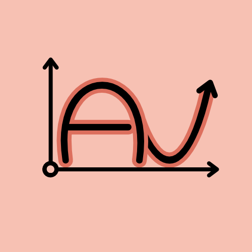

::::::::::::::: {.band .band-lila .hero}
:::::::::::::: band-inner
::::::::::::: hero-flex
::::::::::: hero-texto
```{=html}
<p class="hola"><span class="c1">Hola!</span> <span class="c2">Coucou!</span> <span class="c3">Hello!</span></p>
```

# ¡Bienvenido!

```{=html}
<svg class="wave" width="280" height="16" viewBox="0 0 244 16" aria-hidden="true">
  <path d="M2 8 q15 -10 30 0 t30 0 t30 0 t30 0 t30 0 t30 0 t30 0 t30 0"
        fill="none" stroke="#f19e8c" stroke-width="5" stroke-linecap="round"/>
</svg>
<p class="nombre">@Ana Valladares</p>
```

:::::::::: animated-text
Transformar datos nunca había sido tan

::::::::: flip
<div>

<div>

Divertido

</div>

</div>

<div>

<div>

Claro

</div>

</div>

<div>

<div>

Fácil

</div>

</div>
:::::::::

para todos tus proyectos
::::::::::

[Contáctame](contact.qmd){.btn .btn-primary}
:::::::::::

::: hero-logo
```{=html}
<div class="circulo"></div>
```
:::
:::::::::::::
::::::::::::::
:::::::::::::::

:::::::::::::::::: band
::::::::::::::::: band-inner
## Cómo podemos trabajar juntos?

:::::::::::::::: grid
::: g-col-12
#### Me alegra mucho que estés aquí 🌸

#### Bienvenid\@ a mi sitio personal — un espacio donde comparto mi amor por los datos, la creatividad y, por supuesto, por la enseñanza.

#### Aquí encontrarás contenido sobre R, Python, ciencia de datos y otras cosas que voy explorando en el camino.

#### Si quieres saber cómo puedo ayudarte, aquí te muestro mis servicios:
:::

:::::: {.g-col-12 .g-col-md-4}
::::: {.card .text-white .bg-secondary}
::: card-header
📊 Análisis de datos
:::

::: card-body
<p class="card-text">

Aprovechemos tus datos con estadísticas, gráficos e ideas prácticas — siempre buscando resultados reproducibles y automáticos.

</p>
:::
:::::
::::::

:::::: {.g-col-12 .g-col-md-4}
::::: {.card .text-white .bg-info}
::: card-header
🎓 Formaciones
:::

::: card-body
<p class="card-text">

Talleres y formaciones en R, Python o gestión de datos (lo que requieras) — para que optimices tus análisis y ganes confianza en tus habilidades.

</p>
:::
:::::
::::::

:::::: {.g-col-12 .g-col-md-4}
::::: {.card .text-white .bg-success}
::: card-header
💡 Blog y tips
:::

::: card-body
<p class="card-text">

En mi <a href="projects.qmd" style="color: #0056b3; text-decoration: underline;">blog</a> comparto recursos, tutoriales y reflexiones — desde trucos de código hasta ideas que me inspiran a seguir aprendiendo juntos.

</p>
:::
:::::
::::::
::::::::::::::::
:::::::::::::::::
::::::::::::::::::

:::::: {.band .band-azul}
::::: band-inner
## Herramientas que utilizo

::: pills
[R]{.pill .p1} [Python]{.pill .p2} [Quarto]{.pill .p1} [RStudio]{.pill .p2} [SQL]{.pill .p1} [Tableau]{.pill .p2} [QGIS]{.pill .p1}
:::

::: cita
*"Transformando datos complejos en algo simple, útil y confiable para todos"*
:::

[Mira mi portafolio](projects.qmd){.btn .btn-primary .btn-grande}
:::::
::::::

:::: {.band .band-morada}
::: band-inner
## ¿ Quieres trabajar juntos ?

### Siéntete libre de explorar mi sitio y contactarme, estaré feliz de conectar. ¡Nos vemos!

[Contáctame](contact.qmd){.btn .btn-light}
:::
::::

::: calendly-badge
```{=html}
<link href="https://assets.calendly.com/assets/external/widget.css" rel="stylesheet">
<script src="https://assets.calendly.com/assets/external/widget.js" type="text/javascript" async></script>
<script type="text/javascript">window.onload = function() { Calendly.initBadgeWidget({ url: 'https://calendly.com/anapaodares/30min?primary_color=26c595', text: '📅 ¿Platicamos?', color: '#6f42c1', textColor: '#ffffff', branding: false }); }</script>
```
:::
