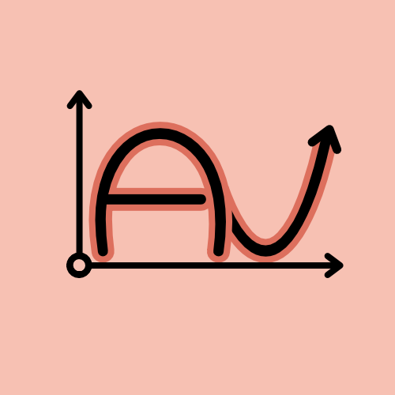
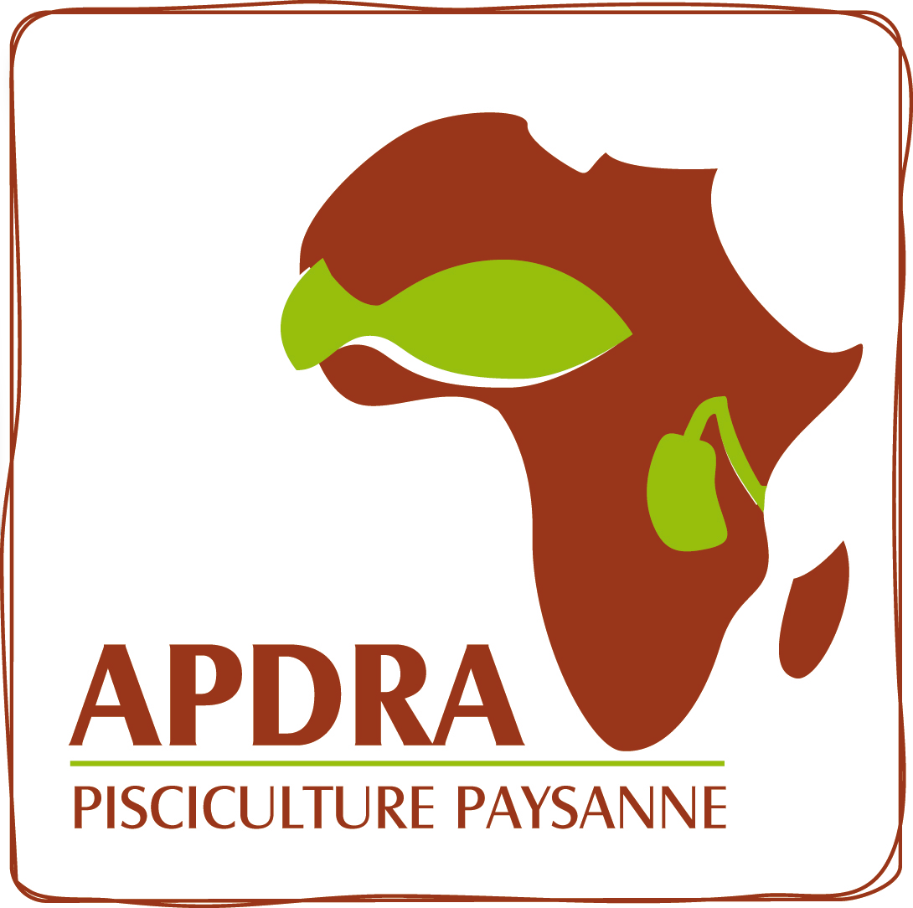
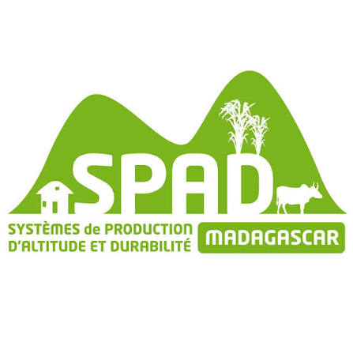
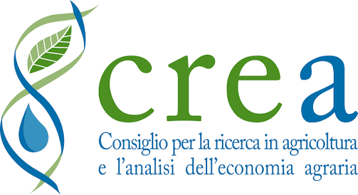
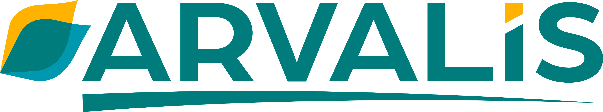

::::::::::::::: {.band .band-lila .hero}
:::::::::::::: band-inner
::::::::::::: hero-flex
::::::::::: hero-texto
```{=html}
<p class="hola"><span class="c1">Hola!</span> <span class="c2">Coucou!</span> <span class="c3">Hello!</span></p>
```

# Bienvenue!

```{=html}
<svg class="wave" width="280" height="16" viewBox="0 0 244 16" aria-hidden="true">
  <path d="M2 8 q15 -10 30 0 t30 0 t30 0 t30 0 t30 0 t30 0 t30 0 t30 0"
        fill="none" stroke="#f19e8c" stroke-width="5" stroke-linecap="round"/>
</svg>
<p class="nombre">@Ana Valladares</p>
```

:::::::::: animated-text
Rendre tes données

::::::::: flip
<div>

<div>

accessibles

</div>

</div>

<div>

<div>

claires

</div>

</div>

<div>

<div>

plus fun

</div>

</div>
:::::::::

pour booster tes projets!
::::::::::

[Me contacter](contact.qmd){.btn .btn-primary}
:::::::::::

::: hero-logo
```{=html}
<div class="circulo"></div>
```
:::
:::::::::::::
::::::::::::::
:::::::::::::::

:::::::::::::::::: band
::::::::::::::::: band-inner
## Comment je peux t'aider

:::::::::::::::: grid
::: g-col-12
#### Je suis ravie que tu sois ici ! 🌸 {.g-col-12}

#### Bienvenue sur mon site personnel — un espace où je partage mon amour pour les données, la créativité et, bien sûr, l'enseignement. {.g-col-12}

#### Ici, tu trouveras du contenu sur R, Python, la science des données et d'autres choses que j'explore. {.g-col-12}

#### Si tu es curieux·se de savoir comment je peux t'aider, voici mes services : {.g-col-12}
:::

:::::: {.g-col-12 .g-col-md-4}
::::: {.card .text-white .bg-secondary}
::: card-header
📊 Analyse de données
:::

::: card-body
<p class="card-text">

Valorisons vos données avec statistiques, graphiques et idées claires — toujours avec des résultats reproductibles et automatisés.

</p>
:::
:::::
::::::

:::::: {.g-col-12 .g-col-md-4}
::::: {.card .text-white .bg-info}
::: card-header
🎓 Formations
:::

::: card-body
<p class="card-text">

Ateliers et formations en R, Python ou gestion de données — pour optimiser vos analyses et développer vos compétences en toute confiance.

</p>
:::
:::::
::::::

:::::: {.g-col-12 .g-col-md-4}
::::: {.card .text-white .bg-danger}
::: card-header
💡 Blog et conseils
:::

::: card-body
<p class="card-text">

Sur mon <a href="projects.qmd" style="color: #0056b3; text-decoration: underline;">blog</a>, je partage ressources, tutos et réflexions — des astuces de code aux idées qui m'inspirent.

</p>
:::
:::::
::::::
::::::::::::::::
:::::::::::::::::
::::::::::::::::::

:::::: {.band .band-azul}
::::: band-inner
## Outils que j'utilise

::: pills
[R]{.pill .p1} [Python]{.pill .p2} [Quarto]{.pill .p1} [RStudio]{.pill .p2} [SQL]{.pill .p1} [Tableau]{.pill .p2} [QGIS]{.pill .p1}
:::

[Voir le portfolio](projects.qmd){.btn .btn-primary .btn-grande}
:::::
::::::

:::: {.band .band-durazno}
::: band-inner
## Notre réseau

### Découvrez les organismes et collectifs avec lesquels AV a eu et a toujours le plaisir de collaborer.

```{=html}
<div class="partner-row partner-formatrice">
  <div class="partner-label">
    <div class="partner-role">Formatrice</div>
    <div class="partner-desc">Formations en R et gestion de données</div>
  </div>
  <div class="partner-tiles">
    <div class="tile cuadro"></div>
    <div class="tile cuadro"></div>
  </div>
</div>

<div class="partner-row partner-analyste">
  <div class="partner-label">
    <div class="partner-role">Analyste de données</div>
    <div class="partner-desc">Analyse, statistiques et reporting</div>
  </div>
  <div class="partner-tiles">
    <div class="tile"></div>
    <div class="tile"></div>
  </div>
</div>
```
:::
::::

:::: {.band .band-morada}
::: band-inner
## On travaille ensemble ?

### N'hésite pas à explorer mon site et à me contacter, je serai ravie d'échanger avec toi. – À bientôt !

::: cita
*« Rendre les données complexes simples, utiles et fiables pour tous. »*
:::

[Me contacter](contact.qmd){.btn .btn-light}
:::
::::

::: calendly-badge
```{=html}
<div class="calendly-badge">
<link href="https://assets.calendly.com/assets/external/widget.css" rel="stylesheet">
<script src="https://assets.calendly.com/assets/external/widget.js" type="text/javascript" async></script>
<script type="text/javascript">window.onload = function() { Calendly.initBadgeWidget({ url: 'https://calendly.com/anapaodares/30min?primary_color=26c595', text: '📅 Parlons-en!', color: '#6f42c1', textColor: '#ffffff', branding: false }); }</script>
</div>
```
:::
