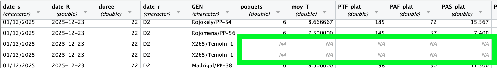

Jumping straight into R without a clear plan often leads to messy scripts and wasted time, specially for begginers.

So a nice tip, is to think ahead of what we really need to do and design a solid pipeline.

Before you write a single line of code, ask yourself these five essential questions to set your R analysis up for success.

#### 1. What is the exact problem I am trying to solve?

\
It sounds weird, but maybe we can start with the end, try to find out what is your final goal.

*Are you describing past trends, predicting future outcomes, or testing a specific hypothesis?*

Defining your primary objective determines which statistical methods and R packages you will need.

#### **2. What does my raw data actually look like?**

\
I know, this sounds boooooriiing, but really we need to check out our raw data, have it saved somewhere (please never delete it or overwrite it!!) to come back to it later if needed.

Very importand and normally forgetted is to **ask yourself where the data came from** : what each column represents, and what might be missing.

In R, make functions like `summary()` is your best friend to uncover hidden quirks early.

#### **3. How will I handle missing values and outliers?**

\
Real-world data is rarely clean or ,as we R users like to say, tidy.

Decide ahead of time how you will treat `NA` values and extreme data points.

{fig-align="center"}

*Will you filter them out, impute them with averages, or keep them because they hold valuable information?*

Documenting this choice prevents bias later on.

#### **4. Which variables actually matter?**

\
More data does not always mean better results.

Identify your target variable (what you want to explain) and your predictor variables (what might explain it).

This helps you avoid unnecessary complexity and keeps your R scripts fast and readable.

#### **5. How will I communicate the final results?**

\
Think about your audience.

A technical team might want statistical test outputs and p-values, while business stakeholders prefer clear visuals. Knowing this early helps you design clean `ggplot2` charts or an automated `Quarto` report right from the start.

------------------------------------------------------------------------

Great data analysis is 80% preparation and 20% execution!

By answering these five questions first, your R code will be cleaner, faster, and much easier to reproduce.

*Want personalized support to work through your own questions and analyses?*

I offer training and one-on-one coaching in R or Python and data analysis, tailored to your data and your goals.

***Get in touch to plan a session!***
