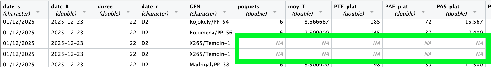

Lanzarse directamente a programar en R sin un plan claro suele terminar en scripts desordenados y pérdida de tiempo, especialmente para quienes están empezando.

Por eso, un buen consejo es pensar con anticipación qué es lo que realmente necesitamos hacer y diseñar un flujo de trabajo (*pipeline*) sólido.

Antes de escribir una sola línea de código, hazte estas cinco preguntas esenciales para asegurar el éxito de tu análisis en R:

#### **1. ¿Cuál es el problema exacto que intento resolver?**

Suena extraño, pero a veces es mejor empezar por el final e intentar descubrir cuál es tu objetivo definitivo.

*¿Estás describiendo tendencias pasadas, prediciendo resultados futuros o poniendo a prueba una hipótesis específica?*

Definir tu objetivo principal determinará qué métodos estadísticos y qué paquetes de R vas a necesitar.

#### **2. ¿Cómo se ven realmente mis datos crudos?**

Lo sé, esto suena a-bu-rri-dí-si-mo, pero de verdad necesitamos revisar nuestros datos originales y tenerlos guardados en algún lugar (¡¡por favor, nunca los borres ni los sobrescribas!!) para poder volver a ellos más adelante si hace falta.

Algo muy importante, y que normalmente se olvida, es preguntarse de dónde vienen los datos: *qué representa cada columna y qué información podría faltar.*

En R, haz que funciones como `summary()` sean tus mejores amigas para descubrir detalles ocultos desde el principio.

#### **3. ¿Cómo voy a manejar los valores faltantes y los datos atípicos?**

Los datos del mundo real rara vez están limpios o, como nos gusta decir a los usuarios de R, ordenados (*tidy*).

Decide de antemano cómo vas a tratar los valores `NA` y los puntos extremos (*outliers*).

{fig-align="center"}

*¿Los vas a filtrar y eliminar, los vas a imputar usando promedios o los vas a conservar porque contienen información valiosa?*

Documentar esta decisión evita sesgos más adelante en el análisis.

**4. ¿Qué variables importan realmente?**

Tener más datos no siempre significa obtener mejores resultados.

Identifica tu variable objetivo (lo que quieres explicar) y tus variables predictoras (lo que podría explicarlo).

Esto te ayudará a evitar complejidades innecesarias y mantendrá tus scripts de R rápidos y fáciles de leer.

**5. ¿Cómo voy a comunicar los resultados finales?**

Piensa en tu audiencia.

Un equipo técnico probablemente querrá ver los resultados de las pruebas estadísticas y los valores *p* (*p-values*), mientras que los directivos o clientes preferirán gráficos claros.

Saber esto desde el inicio te ayudará a diseñar visualizaciones limpias con `ggplot2` o un reporte automatizado en Quarto desde el primer momento.

------------------------------------------------------------------------

¡Un gran análisis de datos es 80 % preparación y 20 % ejecución!

Al responder estas cinco preguntas primero, tu código en R será más limpio, más rápido y mucho más fácil de reproducir.

*¿Quieres apoyo personalizado para resolver tus propias dudas y avanzar con tus análisis?*

Ofrezco capacitaciones y asesorías individuales (1 a 1) en R o Python y análisis de datos, adaptadas a tus propios datos y objetivos.

***¡Ponte en contacto conmigo para planificar una sesión!***
