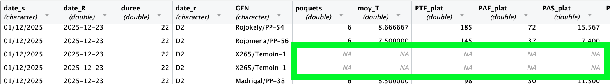

Se lancer directement dans R sans un plan clair mène souvent à des scripts désordonnés et à une perte de temps, surtout pour les débutants.

Un bon conseil consiste donc à réfléchir à l'avance à ce que l'on doit réellement faire et à concevoir un flux de travail (*pipeline*) solide.

Avant d'écrire la moindre ligne de code, pose-toi ces cinq questions essentielles pour assurer la réussite de ton analyse sous R :

#### **1. Quel est le problème exact que j'essaie de résoudre ?**

Cela peut sembler étrange, mais il est parfois préférable de commencer par la fin et de chercher à définir ton objectif final.

*Cherches-tu à décrire des tendances passées, à prédire des résultats futurs ou à tester une hypothèse précise ?*

Définir ton objectif principal déterminera les méthodes statistiques et les packages R dont tu auras besoin.

#### **2. À quoi ressemblent réellement mes données brutes ?**

Je sais, cela semble en-nu-yeux à mourir, mais il est vraiment indispensable d'examiner nos données brutes et de les sauvegarder quelque part (s'il te plaît, ne les supprime jamais et ne les écrase jamais !!) afin de pouvoir y revenir plus tard si nécessaire.

Un point très important, et souvent oublié, est de se demander d'où viennent les données : ce que représente chaque colonne et quelles informations pourraient manquer.

Dans R, fais de fonctions comme `summary()` tes meilleures alliées pour repérer dès le départ les particularités cachées.

#### **3. Comment vais-je gérer les valeurs manquantes et les valeurs aberrantes ?**

Les données du monde réel sont rarement propres ou, comme nous aimons le dire entre utilisateurs de R, ordonnées (*tidy*).

Décide à l'avance de la manière dont tu vas traiter les valeurs `NA` et les points extrêmes (*outliers*).

{fig-align="center"}

*Vas-tu les filtrer pour les supprimer, les imputer à l'aide de moyennes ou les conserver parce qu'elles contiennent des informations précieuses ?*

Documenter ce choix permet d'éviter tout biais par la suite.

#### **4. Quelles variables comptent vraiment ?**

Avoir plus de données ne garantit pas toujours de meilleurs résultats.

Identifie ta variable cible (ce que tu veux expliquer) et tes variables prédictives (ce qui pourrait l'expliquer).

Cela t'aidera à éviter une complexité inutile et à garder des scripts R rapides et faciles à lire.

#### **5. Comment vais-je communiquer les résultats finaux ?**

Pense à ton public.

Une équipe technique voudra sans doute voir les résultats des tests statistiques et les valeurs *p* (*p-values*), tandis que les décideurs ou les clients préféreront des graphiques clairs.

Le savoir dès le début t'aidera à concevoir des visualisations soignées avec `ggplot2` ou un rapport automatisé avec Quarto dès le départ.

------------------------------------------------------------------------

Une excellente analyse de données, c'est 80 % de préparation et 20 % d'exécution !

En répondant d'abord à ces cinq questions, ton code R sera plus propre, plus rapide et beaucoup plus facile à reproduire.

*Tu souhaites un accompagnement personnalisé pour avancer sur tes propres questions et analyses ?*

Je propose des formations et du coaching individuel en R ou Python et en analyse de données, adaptés à tes données et à tes objectifs.

***Contacte-moi pour planifier une séance !***
