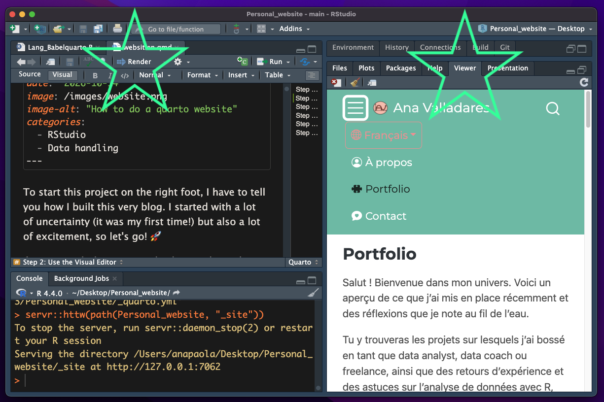
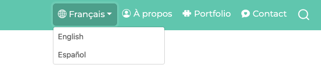

If you are hesitating to launch your own website to post your thoughts as a blog, to show off your portfolio of data analysis projects or just want one to write on, let me explain how I built this very blog.

I started with a lot of uncertainty too (it was my first time!) but with practice and patience, everything is possible!

I'm not a web designer. My background is **data analysis**, so programming in RStudio was my ally here.

To understand how a website works (and design your own), you'll need to learn a tiny bit about **HTML, CSS and JavaScript**, but don't worry, Quarto does most of the heavy lifting.

#### Step 1: Choose Your Adventure

Quarto works with several editors, so you can choose Jupyter if you are more comfortable with Python, VS Code, or, if you are an R lover like me, you will start by:

1.  Install [R](https://cran.r-project.org/) and [RStudio](https://posit.co/download/rstudio-desktop/)
2.  Install [Quarto](https://quarto.org/docs/get-started/)
3.  Create a new project: *File → New Project → Quarto Website*

#### Step 2: Use the Visual Editor

If you're using RStudio, the **Visual Editor** is your best friend.

It's *what you see is what you get*, so it works like Word: you can make text bold, add headings or insert images with buttons.

Then you hit **Render** to preview the result. Misspelling a function, variable, dataset, or package name is one of the most common (and most overlooked) sources of errors.

{fig-align="center"}

#### Step 3: Meet `_quarto.yml`, Your Little Chef

The first thing to learn is the `_quarto.yml` file. Think of it as a little chef who puts everything in order: it decides **what** you show on your site and **how** you show it. It *brings all things together*, so every page you create is connected through this configuration file.

You can choose from many themes on the [official Quarto website](https://quarto.org/docs/output-formats/html-themes.html). I used the **Minty** theme for this blog.

Try it yourself: ***pick a theme***

```{ojs}
//| echo: false
viewof theme = Inputs.select(
  ["minty", "cosmo", "flatly", "journal", "lux", "sketchy", "darkly", "pulse"],
  {label: "Choose a theme:", value: "minty"}
)
```

Here is the code you would put in your `_quarto.yml`:

```{ojs}
//| echo: false
md`
\`\`\`yaml
type: website
website:
  title: "My Blog"
  navbar:
    left:
      - href: index.qmd
        text: Home
      - about.qmd

format:
  html:
    theme: ${theme}
\`\`\`
`
```

Change the theme in the dropdown and the code updates automatically. Copy it!

#### Step 4: Understand Your Files

Each page of your site is a `.qmd` file. A basic project looks like this:

```         
├── _quarto.yml         # Website configuration file
├── about.qmd           # About page
├── index.qmd           # Landing page
├── my-website.Rproj    # RStudio project config file
└── styles.css          # CSS style sheet
```

::: {.callout-tip collapse="true"}
## 👆 Click to learn what each file does

-   **`_quarto.yml`**: the "chef"; controls the whole site's configuration
-   **`index.qmd`**: your landing page (the first thing visitors see)
-   **`about.qmd`**: a page to tell people who you are
-   **`.Rproj`**: tells RStudio this folder is a project
-   **`styles.css`**: your custom styling, once you want to go beyond themes
:::

#### Step 5: Going Multilingual

{fig-align="center"}

Our blog is written in **Spanish, English and French**, because we are fluent in all three. To do this I used the **`babelquarto`** package.

::: callout-important
## Important!

With `babelquarto` you should **not** click *Render Website*. Instead, run the code directly in the console:

``` r
babelquarto::render_website()
```

This gives you a preview with all languages already set up.
:::

Behind the scenes, this converts all your `.qmd` files into **HTML files**, the key building blocks of any website.

#### Step 6: Where Does the Website Live?

Your website is rendered into the **`_site`** folder. You can even double-click any `.html` file in there and open it in your browser to see how it looks. This folder **updates every time you run the code**.

#### Your Turn!! Mini Quiz: What's Your Quarto Setup?

Answer three quick questions and I'll tell you where to start.

```{ojs}
//| echo: false
viewof q1 = Inputs.radio(
  ["R / data analysis", "Python", "I'm brand new to coding"],
  {label: "1. What's your background?"}
)
```

```{ojs}
//| echo: false
viewof q2 = Inputs.radio(
  ["A personal blog", "A portfolio of my work", "Course notes or documentation"],
  {label: "2. What will your site be for?"}
)
```

```{ojs}
//| echo: false
viewof q3 = Inputs.radio(
  ["Fresh and friendly", "Clean and professional", "Dark and bold"],
  {label: "3. What vibe are you going for?"}
)
```

```{ojs}
//| echo: false
{
  if (!q1 || !q2 || !q3) {
    return html`<p><em>👆 Answer all three questions to see your result.</em></p>`;
  }

  // Convierte texto con etiquetas (como <code>) en HTML real
  const raw = (s) => {
    const el = document.createElement("span");
    el.innerHTML = s;
    return el;
  };

  const editors = {
    "R / data analysis": ["RStudio", "Create a new project: File → New Project → Quarto Website."],
    "Python": ["Jupyter or VS Code", "Run <code>quarto create project website my-website</code> in your terminal."],
    "I'm brand new to coding": ["RStudio + Visual Editor", "It works like Word, so you can start writing right away."]
  };

  const themes = {
    "Fresh and friendly": ["minty", "Light, green and welcoming. This is the one I use!"],
    "Clean and professional": ["flatly", "Simple, modern and easy to read."],
    "Dark and bold": ["darkly", "Dark background that makes your content pop."]
  };

  const pages = {
    "A personal blog": "Start with <code>index.qmd</code> and a <code>posts/</code> folder.",
    "A portfolio of my work": "Use a listing page to show your projects as cards.",
    "Course notes or documentation": "Add a sidebar navigation in <code>_quarto.yml</code>."
  };

  const [editor, editorTip] = editors[q1];
  const [themeName, themeTip] = themes[q3];

  return html`<div style="border:2px solid #593196; border-radius:10px; padding:1em 1.5em; margin-top:1em;">
    <h4>🎉 Your recommended setup</h4>
    <p><strong>Editor:</strong> ${editor}<br><small>${raw(editorTip)}</small></p>
    <p><strong>Theme:</strong> <code>${themeName}</code><br><small>${themeTip}</small></p>
    <p><strong>First step:</strong> ${raw(pages[q2])}</p>
    <p>Add this to your <code>_quarto.yml</code>:</p>
    <pre><code>format:
  html:
    theme: ${themeName}</code></pre>
  </div>`;
}
```

------------------------------------------------------------------------

Which editor did you pick, and which theme are you going with?

***Get in touch to plan a session!***

References:

-   Jadey Ryan: [Beginner Quarto + Netlify](https://jadeyryan.com/blog/2024-02-19_beginner-quarto-netlify/)
-   Joel Nitta: [babelquarto](https://www.joelnitta.com/posts/2024-12-06_babelquarto/#render)
-   [Quarto Websites documentation](https://quarto.org/docs/websites/)
-   This post was written with the help of Claude (Anthropic's AI), based on my own original ideas and experience.
