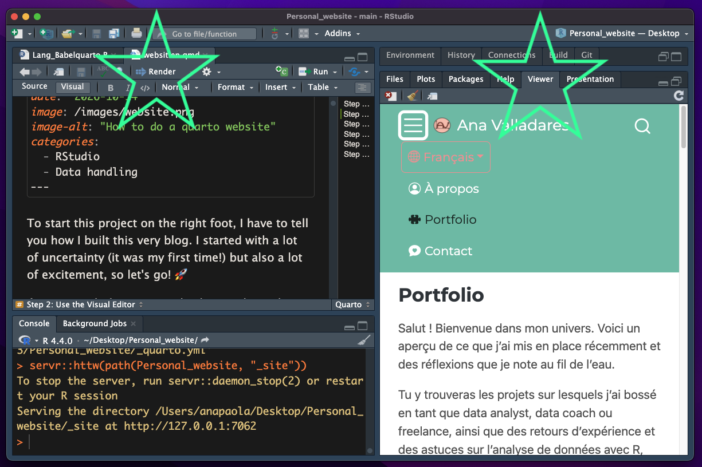
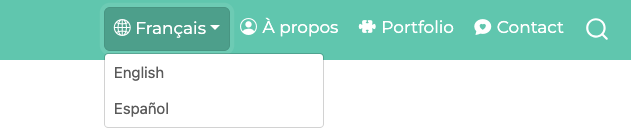

Si dudas en lanzar tu propio sitio web para publicar tus ideas como blog, mostrar tu portafolio de proyectos de análisis de datos o simplemente tener un espacio donde escribir, déjame explicarte cómo construí este mismo blog. Yo también empecé con mucha incertidumbre (¡era mi primera vez!), pero con práctica y paciencia, ¡todo es posible!

No soy diseñadora web. Mi formación es en **análisis de datos**, así que programar en RStudio fue mi aliado.

Para entender cómo funciona un sitio web (y diseñar el tuyo), necesitarás aprender un poquito de **HTML, CSS y JavaScript**, pero no te preocupes: Quarto hace la mayor parte del trabajo pesado.

#### Paso 1: Elige tu aventura

Quarto funciona con varios editores, así que puedes elegir Jupyter si te sientes más cómoda/o con Python, VS Code o, si eres fan de R como yo, empezarás así:

1.  Instala [R](https://cran.r-project.org/) y [RStudio](https://posit.co/download/rstudio-desktop/)
2.  Instala [Quarto](https://quarto.org/docs/get-started/)
3.  Crea un nuevo proyecto: *File → New Project → Quarto Website*

#### Paso 2: Usa el editor visual

Si usas RStudio, el **Visual Editor** (editor visual) es tu mejor amigo.

Es *lo que ves es lo que obtienes*, así que funciona como Word: puedes poner texto en negrita, añadir títulos o insertar imágenes con botones.

Luego haces clic en **Render** para ver una vista previa del resultado. Escribir mal el nombre de una función, variable, base de datos o paquete es una de las fuentes de error más comunes (y más pasadas por alto).

{fig-align="center"}

#### Paso 3: Conoce `_quarto.yml`, tu pequeño chef

Lo primero que debes aprender es el archivo `_quarto.yml`. Piensa en él como un pequeño chef que pone todo en orden: decide **qué** muestras en tu sitio y **cómo** lo muestras. *Reúne todo*, así que cada página que creas queda conectada a través de este archivo de configuración.

Puedes elegir entre muchos temas en el [sitio oficial de Quarto](https://quarto.org/docs/output-formats/html-themes.html). Yo usé el tema **Minty** para este blog.

Pruébalo tú: ***elige un tema***

```{ojs}
//| echo: false
viewof theme = Inputs.select(
  ["minty", "cosmo", "flatly", "journal", "lux", "sketchy", "darkly", "pulse"],
  {label: "Elige un tema:", value: "minty"}
)
```

Este es el código que pondrías en tu `_quarto.yml`:

```{ojs}
//| echo: false
md`
\`\`\`yaml
type: website
website:
  title: "Mi blog"
  navbar:
    left:
      - href: index.qmd
        text: Inicio
      - about.qmd

format:
  html:
    theme: ${theme}
\`\`\`
`
```

Cambia el tema en el menú desplegable y el código se actualiza automáticamente. ¡Cópialo!

#### Paso 4: Entiende tus archivos

Cada página de tu sitio es un archivo `.qmd`. Un proyecto básico se ve así:

```         
├── _quarto.yml         # Archivo de configuración del sitio
├── about.qmd           # Página "Sobre mí"
├── index.qmd           # Página de inicio
├── my-website.Rproj    # Configuración del proyecto de RStudio
└── styles.css          # Hoja de estilos CSS
```

::: {.callout-tip collapse="true"}
## 👆 Haz clic para saber qué hace cada archivo

-   **`_quarto.yml`**: el "chef"; controla la configuración de todo el sitio
-   **`index.qmd`**: tu página de inicio (lo primero que ven los visitantes)
-   **`about.qmd`**: una página para contar quién eres
-   **`.Rproj`**: le dice a RStudio que esta carpeta es un proyecto
-   **`styles.css`**: tu estilo personalizado, cuando quieras ir más allá de los temas
:::

#### Paso 5: Un sitio multilingüe

{fig-align="center"}

Nuestro blog está escrito en **español, inglés y francés**, porque dominamos los tres idiomas. Para lograrlo usé el paquete **`babelquarto`**.

::: callout-important
## ¡Importante!

Con `babelquarto` **no** debes hacer clic en *Render Website*. En su lugar, ejecuta el código directamente en la consola:

``` r
babelquarto::render_website()
```

Esto te da una vista previa con todos los idiomas ya configurados.
:::

Detrás de escena, esto convierte todos tus archivos `.qmd` en **archivos HTML**, las piezas básicas de cualquier sitio web.

#### Paso 6: ¿Dónde vive el sitio web?

Tu sitio web se genera en la carpeta **`_site`**. Incluso puedes hacer doble clic en cualquier archivo `.html` de ahí y abrirlo en tu navegador para ver cómo queda. Esta carpeta **se actualiza cada vez que ejecutas el código**.

#### ¡Tu turno! Mini quiz: ¿cuál es tu configuración ideal de Quarto?

Responde tres preguntas rápidas y te diré por dónde empezar.

```{ojs}
//| echo: false
viewof q1 = Inputs.radio(
  ["R / análisis de datos", "Python", "Soy nueva/o en programación"],
  {label: "1. ¿Cuál es tu experiencia?"}
)
```

```{ojs}
//| echo: false
viewof q2 = Inputs.radio(
  ["Un blog personal", "Un portafolio de mi trabajo", "Apuntes de cursos o documentación"],
  {label: "2. ¿Para qué será tu sitio?"}
)
```

```{ojs}
//| echo: false
viewof q3 = Inputs.radio(
  ["Fresco y amigable", "Limpio y profesional", "Oscuro y llamativo"],
  {label: "3. ¿Qué estilo buscas?"}
)
```

```{ojs}
//| echo: false
{
  if (!q1 || !q2 || !q3) {
    return html`<p><em>👆 Responde las tres preguntas para ver tu resultado.</em></p>`;
  }

  // Convierte texto con etiquetas (como <code>) en HTML real
  const raw = (s) => {
    const el = document.createElement("span");
    el.innerHTML = s;
    return el;
  };

  const editors = {
    "R / análisis de datos": ["RStudio", "Crea un nuevo proyecto: File → New Project → Quarto Website."],
    "Python": ["Jupyter o VS Code", "Ejecuta <code>quarto create project website my-website</code> en tu terminal."],
    "Soy nueva/o en programación": ["RStudio + Visual Editor", "Funciona como Word, así que puedes empezar a escribir de inmediato."]
  };

  const themes = {
    "Fresco y amigable": ["minty", "Claro, verde y acogedor. ¡Es el que yo uso!"],
    "Limpio y profesional": ["flatly", "Simple, moderno y fácil de leer."],
    "Oscuro y llamativo": ["darkly", "Fondo oscuro que hace resaltar tu contenido."]
  };

  const pages = {
    "Un blog personal": "Empieza con <code>index.qmd</code> y una carpeta <code>posts/</code>.",
    "Un portafolio de mi trabajo": "Usa una página de listado para mostrar tus proyectos como tarjetas.",
    "Apuntes de cursos o documentación": "Añade una barra de navegación lateral en <code>_quarto.yml</code>."
  };

  const [editor, editorTip] = editors[q1];
  const [themeName, themeTip] = themes[q3];

  return html`<div style="border:2px solid #593196; border-radius:10px; padding:1em 1.5em; margin-top:1em;">
    <h4>🎉 Tu configuración recomendada</h4>
    <p><strong>Editor:</strong> ${editor}<br><small>${raw(editorTip)}</small></p>
    <p><strong>Tema:</strong> <code>${themeName}</code><br><small>${themeTip}</small></p>
    <p><strong>Primer paso:</strong> ${raw(pages[q2])}</p>
    <p>Añade esto a tu <code>_quarto.yml</code>:</p>
    <pre><code>format:
  html:
    theme: ${themeName}</code></pre>
  </div>`;
}
```

------------------------------------------------------------------------

¿Qué editor elegiste y con qué tema te quedas?

***¡Contáctame para planear una sesión!***

Referencias:

-   Jadey Ryan: [Beginner Quarto + Netlify](https://jadeyryan.com/blog/2024-02-19_beginner-quarto-netlify/)
-   Joel Nitta: [babelquarto](https://www.joelnitta.com/posts/2024-12-06_babelquarto/#render)
-   [Documentación de Quarto Websites](https://quarto.org/docs/websites/)
-   Esta publicación fue escrita con la ayuda de Claude (la IA de Anthropic), a partir de mis propias ideas y experiencia.
