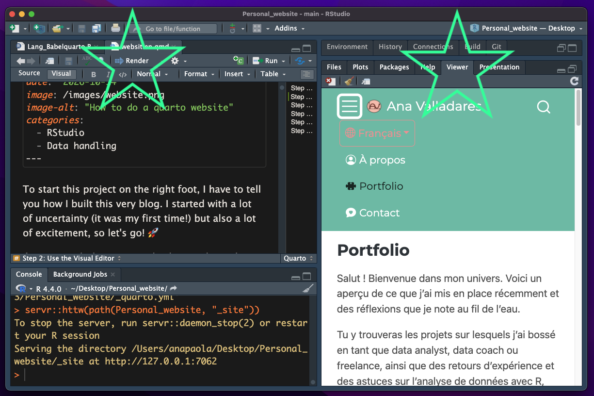
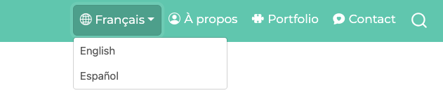

Si tu hésites à lancer ton propre site web pour publier tes idées sous forme de blog, présenter ton portfolio de projets d'analyse de données ou simplement avoir un espace où écrire, laisse-moi t'expliquer comment j'ai construit ce blog. J'ai moi aussi commencé avec beaucoup d'incertitude (c'était ma première fois !), mais avec de la pratique et de la patience, tout est possible !

Je ne suis pas web designer. Mon domaine, c'est l'**analyse de données**, donc programmer dans RStudio a été mon allié.

Pour comprendre comment fonctionne un site web (et concevoir le tien), tu devras apprendre un tout petit peu de **HTML, CSS et JavaScript**, mais ne t'inquiète pas : Quarto fait le gros du travail.

#### Étape 1 : Choisis ton aventure

Quarto fonctionne avec plusieurs éditeurs : tu peux choisir Jupyter si tu es plus à l'aise avec Python, VS Code ou, si tu es fan de R comme moi, tu commenceras ainsi :

1.  Installe [R](https://cran.r-project.org/) et [RStudio](https://posit.co/download/rstudio-desktop/)
2.  Installe [Quarto](https://quarto.org/docs/get-started/)
3.  Crée un nouveau projet : *File → New Project → Quarto Website*

#### Étape 2 : Utilise l'éditeur visuel

Si tu utilises RStudio, le **Visual Editor** (éditeur visuel) est ton meilleur ami.

C'est du *ce que tu vois est ce que tu obtiens*, donc il fonctionne comme Word : tu peux mettre du texte en gras, ajouter des titres ou insérer des images avec des boutons.

Ensuite, clique sur **Render** pour prévisualiser le résultat. Faire une faute de frappe dans le nom d'une fonction, d'une variable, d'un jeu de données ou d'un package est l'une des sources d'erreurs les plus courantes (et les plus négligées).

{fig-align="center"}

#### Étape 3 : Fais connaissance avec `_quarto.yml`, ton petit chef

La première chose à apprendre, c'est le fichier `_quarto.yml`. Pense à lui comme à un petit chef qui met tout en ordre : il décide de **ce que** tu montres sur ton site et de **la façon dont** tu le montres. Il *réunit tout*, donc chaque page que tu crées est reliée par ce fichier de configuration.

Tu peux choisir parmi de nombreux thèmes sur le [site officiel de Quarto](https://quarto.org/docs/output-formats/html-themes.html). J'ai utilisé le thème **Minty** pour ce blog.

Essaie toi-même : ***choisis un thème***

```{ojs}
//| echo: false
viewof theme = Inputs.select(
  ["minty", "cosmo", "flatly", "journal", "lux", "sketchy", "darkly", "pulse"],
  {label: "Choisis un thème :", value: "minty"}
)
```

Voici le code que tu mettrais dans ton `_quarto.yml` :

```{ojs}
//| echo: false
md`
\`\`\`yaml
type: website
website:
  title: "Mon blog"
  navbar:
    left:
      - href: index.qmd
        text: Accueil
      - about.qmd

format:
  html:
    theme: ${theme}
\`\`\`
`
```

Change le thème dans le menu déroulant et le code se met à jour automatiquement. Copie-le !

#### Étape 4 : Comprends tes fichiers

Chaque page de ton site est un fichier `.qmd`. Un projet de base ressemble à ceci :

```         
├── _quarto.yml         # Fichier de configuration du site
├── about.qmd           # Page « À propos »
├── index.qmd           # Page d'accueil
├── my-website.Rproj    # Configuration du projet RStudio
└── styles.css          # Feuille de style CSS
```

::: {.callout-tip collapse="true"}
## 👆 Clique pour savoir à quoi sert chaque fichier

-   **`_quarto.yml`** : le « chef » ; il contrôle la configuration de tout le site
-   **`index.qmd`** : ta page d'accueil (la première chose que voient les visiteurs)
-   **`about.qmd`** : une page pour dire qui tu es
-   **`.Rproj`** : indique à RStudio que ce dossier est un projet
-   **`styles.css`** : ton style personnalisé, quand tu veux aller plus loin que les thèmes
:::

#### Étape 5 : Un site multilingue

{fig-align="center"}

Notre blog est écrit en **espagnol, anglais et français**, parce que nous maîtrisons les trois langues. Pour cela, j'ai utilisé le package **`babelquarto`**.

::: callout-important
## Important !

Avec `babelquarto`, tu ne dois **pas** cliquer sur *Render Website*. À la place, exécute le code directement dans la console :

``` r
babelquarto::render_website()
```

Tu obtiens ainsi un aperçu avec toutes les langues déjà configurées.
:::

En coulisses, cela convertit tous tes fichiers `.qmd` en **fichiers HTML**, les éléments de base de tout site web.

#### Étape 6 : Où vit le site web ?

Ton site web est généré dans le dossier **`_site`**. Tu peux même double-cliquer sur n'importe quel fichier `.html` qui s'y trouve et l'ouvrir dans ton navigateur pour voir le résultat. Ce dossier **se met à jour chaque fois que tu exécutes le code**.

#### À toi de jouer ! Mini quiz : quelle est ta configuration Quarto idéale ?

Réponds à trois questions rapides et je te dirai par où commencer.

```{ojs}
//| echo: false
viewof q1 = Inputs.radio(
  ["R / analyse de données", "Python", "Je débute en programmation"],
  {label: "1. Quel est ton parcours ?"}
)
```

```{ojs}
//| echo: false
viewof q2 = Inputs.radio(
  ["Un blog personnel", "Un portfolio de mes projets", "Des notes de cours ou de la documentation"],
  {label: "2. À quoi servira ton site ?"}
)
```

```{ojs}
//| echo: false
viewof q3 = Inputs.radio(
  ["Frais et sympathique", "Épuré et professionnel", "Sombre et audacieux"],
  {label: "3. Quelle ambiance recherches-tu ?"}
)
```

```{ojs}
//| echo: false
{
  if (!q1 || !q2 || !q3) {
    return html`<p><em>👆 Réponds aux trois questions pour voir ton résultat.</em></p>`;
  }

  // Convertit du texte avec balises (comme <code>) en vrai HTML
  const raw = (s) => {
    const el = document.createElement("span");
    el.innerHTML = s;
    return el;
  };

  const editors = {
    "R / analyse de données": ["RStudio", "Crée un nouveau projet : File → New Project → Quarto Website."],
    "Python": ["Jupyter ou VS Code", "Exécute <code>quarto create project website my-website</code> dans ton terminal."],
    "Je débute en programmation": ["RStudio + Visual Editor", "Il fonctionne comme Word, tu peux donc commencer à écrire tout de suite."]
  };

  const themes = {
    "Frais et sympathique": ["minty", "Clair, vert et accueillant. C'est celui que j'utilise !"],
    "Épuré et professionnel": ["flatly", "Simple, moderne et facile à lire."],
    "Sombre et audacieux": ["darkly", "Un fond sombre qui fait ressortir ton contenu."]
  };

  const pages = {
    "Un blog personnel": "Commence avec <code>index.qmd</code> et un dossier <code>posts/</code>.",
    "Un portfolio de mes projets": "Utilise une page de listing pour afficher tes projets sous forme de cartes.",
    "Des notes de cours ou de la documentation": "Ajoute une barre de navigation latérale dans <code>_quarto.yml</code>."
  };

  const [editor, editorTip] = editors[q1];
  const [themeName, themeTip] = themes[q3];

  return html`<div style="border:2px solid #593196; border-radius:10px; padding:1em 1.5em; margin-top:1em;">
    <h4>🎉 Ta configuration recommandée</h4>
    <p><strong>Éditeur :</strong> ${editor}<br><small>${raw(editorTip)}</small></p>
    <p><strong>Thème :</strong> <code>${themeName}</code><br><small>${themeTip}</small></p>
    <p><strong>Première étape :</strong> ${raw(pages[q2])}</p>
    <p>Ajoute ceci à ton <code>_quarto.yml</code> :</p>
    <pre><code>format:
  html:
    theme: ${themeName}</code></pre>
  </div>`;
}
```

------------------------------------------------------------------------

Quel éditeur as-tu choisi et quel thème retiens-tu ?

***Contacte-moi pour planifier une séance !***

Références :

-   Jadey Ryan : [Beginner Quarto + Netlify](https://jadeyryan.com/blog/2024-02-19_beginner-quarto-netlify/)
-   Joel Nitta : [babelquarto](https://www.joelnitta.com/posts/2024-12-06_babelquarto/#render)
-   [Documentation de Quarto Websites](https://quarto.org/docs/websites/)
-   Cet article a été rédigé avec l'aide de Claude (l'IA d'Anthropic), à partir de mes propres idées et de mon expérience.
